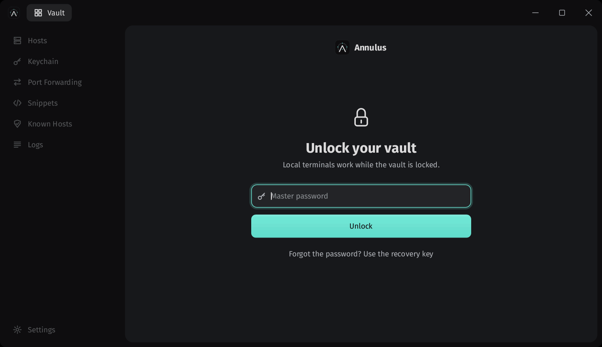
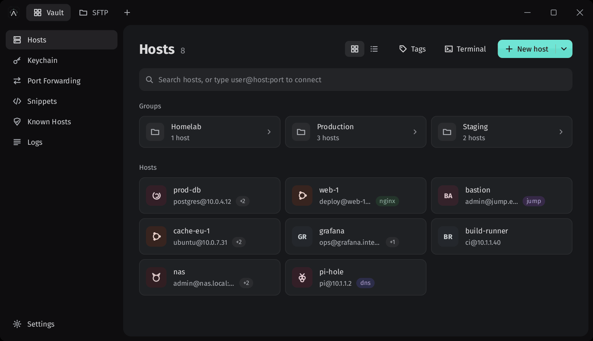
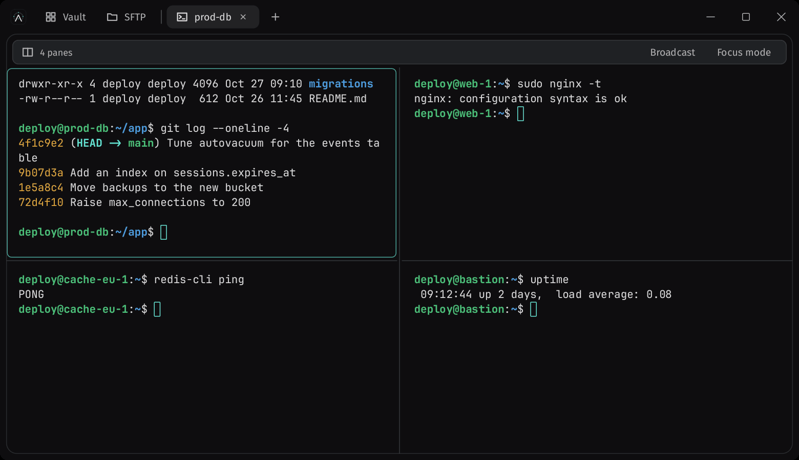
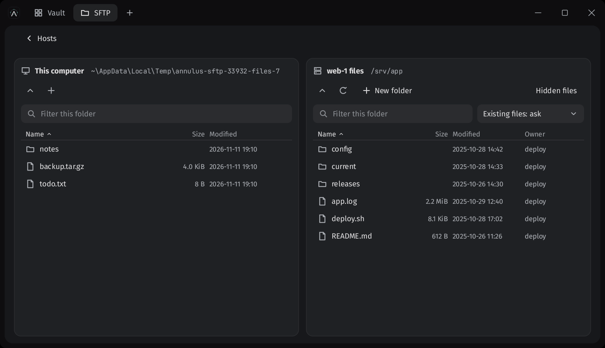
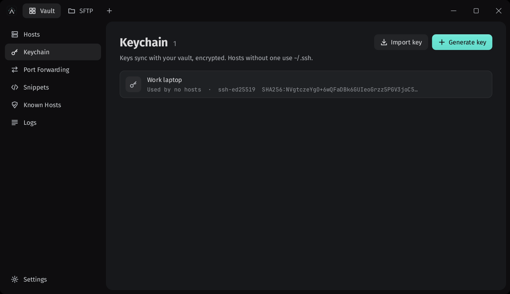
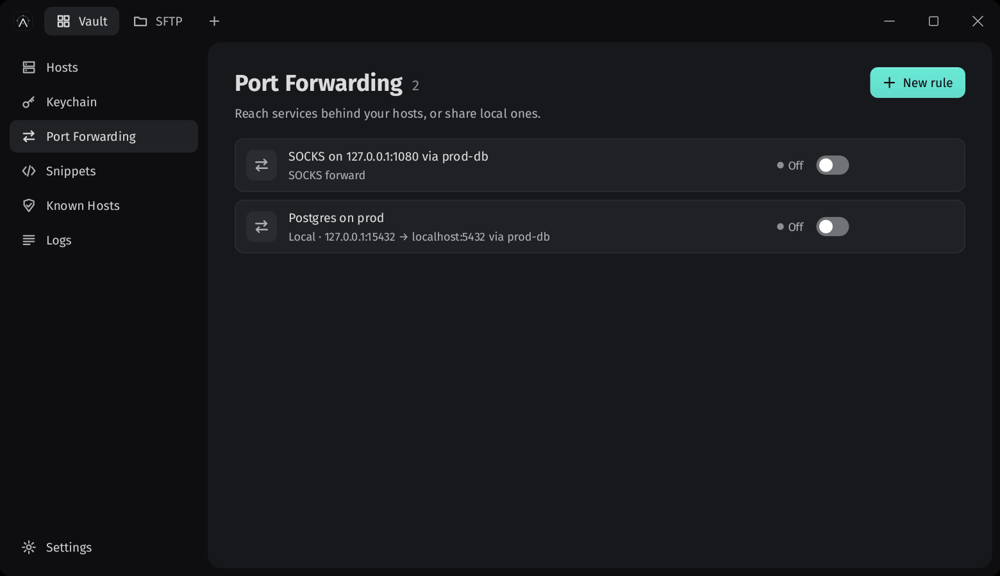
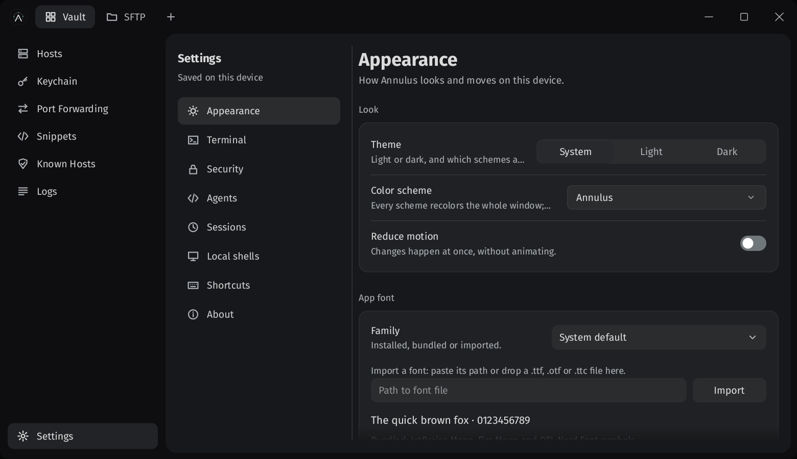

<p align="center">
  
</p>

<h1 align="center">Annulus</h1>

<p align="center">
  A native desktop app for your terminals and SSH servers.<br>
  Free and open source, with sync that runs on your own server.
</p>

<p align="center">
  Windows&nbsp;&nbsp;·&nbsp;&nbsp;macOS&nbsp;&nbsp;·&nbsp;&nbsp;Linux
</p>

<p align="center">
  <a href="#try-it">Try it</a>&nbsp;&nbsp;·&nbsp;&nbsp;<a href="#whats-inside">What's inside</a>&nbsp;&nbsp;·&nbsp;&nbsp;<a href="#sync-on-your-own-server">Sync</a>&nbsp;&nbsp;·&nbsp;&nbsp;<a href="#on-the-way">On the way</a>&nbsp;&nbsp;·&nbsp;&nbsp;<a href="docs/README.md">Docs</a>
</p>



Annulus keeps everything you need to reach your servers in one place: the hosts, the keys that open them, the tunnels and commands you keep needing. It all lives in an encrypted vault on your own computer, and your local shells sit in the same tabs as your SSH sessions.

You don't need an account. Annulus works offline, sends nothing home, and is free, with no paid tier waiting further on. When you want your hosts on a second computer, you run one small server of your own and they sync through it, encrypted so that the server itself can't read them.

It's written in Rust, down to its own UI toolkit, so there's no browser hiding inside. When nothing on screen has changed, it doesn't draw at all. It runs on Windows, macOS and Linux.

## Try it

**Download.** Get Annulus for your system from the [Releases](https://github.com/solarisc/terminal-emu/releases) page. On Windows, run `annulus-setup` to install it for your account (no administrator needed), or take the zip: a folder with `annulus-app` and the `annulus-agent` command that runs from wherever you unpack it. On macOS and Linux, unpack the zip. The sync server is a download of its own. Builds aren't signed yet, so Windows and macOS will ask you to confirm the first time you open one.

**Or build it.** You'll need [Rust](https://rustup.rs) and a C compiler. On Linux, that means `build-essential` and `pkg-config`. Rustup fetches the exact toolchain the project pins, and the first build takes a few minutes.

```bash
git clone https://github.com/solarisc/terminal-emu
cd terminal-emu
cargo run -p annulus-app --release -- --preview
```

`--preview` opens a throwaway vault full of made-up hosts, so you can look around without setting anything up. Leave it off when you're ready to make your own.

## What's inside

Prefer to watch it all in one go? Here's [the full tour](docs/media/annulus-demo.mp4), about a minute and a half with captions.

### Hosts that stay organized

Put your servers in nested groups. A group can hold a username, a key, a jump host or anything else its hosts should share, and each host inherits whatever it doesn't set for itself. Tags and search cut across all of it, and typing `user@host:port` into the search box connects straight away.

Already have an `~/.ssh/config`? Import it, jump hosts and keys included.



### Connections you can see into

Each connection shows its steps as they happen, with the log of what was tried one click away. Jump host chains of any length, SOCKS5 and HTTP proxies and `ProxyCommand` are all there, and a dropped session reconnects by itself with your output intact.

Annulus only runs what you configured, so nothing gets quietly executed on your servers. And if a server's key ever changes, the connection stops and shows you both fingerprints. There's nothing to click through.

### Terminals, split how you like

Local shells and SSH sessions share one tab strip, with PowerShell, cmd, WSL, Git Bash and your login shell found for you. Split a tab into as many as 16 panes, type into all of them at once when you need to, or switch to focus mode for one large pane with the rest listed beside it.



### Files, side by side

Browse your computer and a server next to each other, or two servers, and move files between them. The queue shows what's moving and picks up what was interrupted, and you choose whether files that already exist are kept, skipped or overwritten.



### Keys that go where they're needed

Generate Ed25519, ECDSA or RSA keys, or import the ones you have from OpenSSH, PEM or PuTTY files. Installing a key on a server takes one click: Annulus adds it to `authorized_keys` and links it to the host. When you delete a key, it offers to take it off those servers too, so no forgotten way in stays behind.



### Tunnels, drawn for you

Local, remote and SOCKS forwards, each with a small diagram of where your traffic actually goes as you set it up. Rules run without a terminal open, and can start when your vault unlocks or along with a host's terminal.



### Everything from the keyboard

`Ctrl+Shift+K` (`Cmd+K` on a Mac) opens a palette for your hosts, tabs, snippets and commands. Every shortcut can be changed in Settings.


### Colors you can live with

Light and dark themes of our own, plus 498 community color schemes. Hover over one and the whole window shows it before you choose.



### And the rest

- **Snippets** you can run in a terminal, in every pane of a tab, or across several hosts at once.
- **Session logs**, off by default since output can hold secrets, and encrypted when you turn them on.
- **A screen-reader tree** through AccessKit, plus full keyboard access.
- **A local door for scripts and coding agents**: an `annulus-agent` command and an MCP server. It stays shut until you open it in Settings, and it never hands out a secret. `annulus-agent scp "./file.zip" "42:/tmp/file.zip"` copies through saved host `42`; reverse the paths to download. Copies use SFTP, show in an AI file tab and include safe cleanup advice. See [agent file transfers](docs/adr/0032-agent-file-transfers.md).

## Sync on your own server

Sync is optional, and it's the reason Annulus exists. There's no company in the middle: you run one small server, as a single binary or a Docker image, and sign in from each of your computers.

Your vault is encrypted on your device before anything leaves it, using Argon2id and XChaCha20-Poly1305. Login uses [OPAQUE](https://datatracker.ietf.org/doc/rfc9807/), so the server never sees your password, and it never holds the keys to read your hosts, your credentials or even your host names.

The server keeps earlier versions of each item, deleted items wait in the trash for 30 days, and you can see and revoke your devices. One server can hold separate accounts for a family or a homelab.

The [server guide](docs/server/README.md) gets you running with Docker and automatic HTTPS, or on a home network with the server's own certificate.

The design is written down in the [threat model](docs/SECURITY.md), and reviews are welcome. It hasn't had an external audit yet.

## On the way

Planned for 1.0, and tracked with everything else in [FEATURES.md](docs/FEATURES.md):

- FIDO2 and other hardware-backed keys
- SSH certificates, and keyboard-interactive login for 2FA prompts
- Saved workspaces and command autocomplete
- Installers for macOS and Linux, signed builds and update checks

Team sharing, mobile apps, a built-in AI assistant, Telnet, serial and Mosh are out of scope on purpose, which is what keeps Annulus small enough to get right.

## Contributing

Bug reports and pull requests are very welcome. [CONTRIBUTING.md](CONTRIBUTING.md) explains how the code is laid out and what a change needs before it merges, and [docs/README.md](docs/README.md) maps the design docs. If you've found a security problem, please follow [SECURITY.md](SECURITY.md) rather than opening an issue.

## Thanks

Annulus is built on a lot of good open-source work: [russh](https://github.com/Eugeny/russh) for SSH and SFTP, [Alacritty](https://github.com/alacritty/alacritty)'s terminal core, [winit](https://github.com/rust-windowing/winit), [Parley](https://github.com/linebender/parley) and [tiny-skia](https://github.com/linebender/tiny-skia) for windows and text, [AccessKit](https://github.com/AccessKit/accesskit) for screen readers, [opaque-ke](https://github.com/facebook/opaque-ke) for login, and the [Tinted Theming](https://github.com/tinted-theming/schemes) color schemes.

## License

The app is available under either the [MIT](LICENSE-MIT) or the [Apache-2.0](LICENSE-APACHE) license, at your choice. The sync server is [AGPL-3.0-or-later](crates/annulus-server/LICENSE), so anyone who offers a modified server to others shares their changes too.
